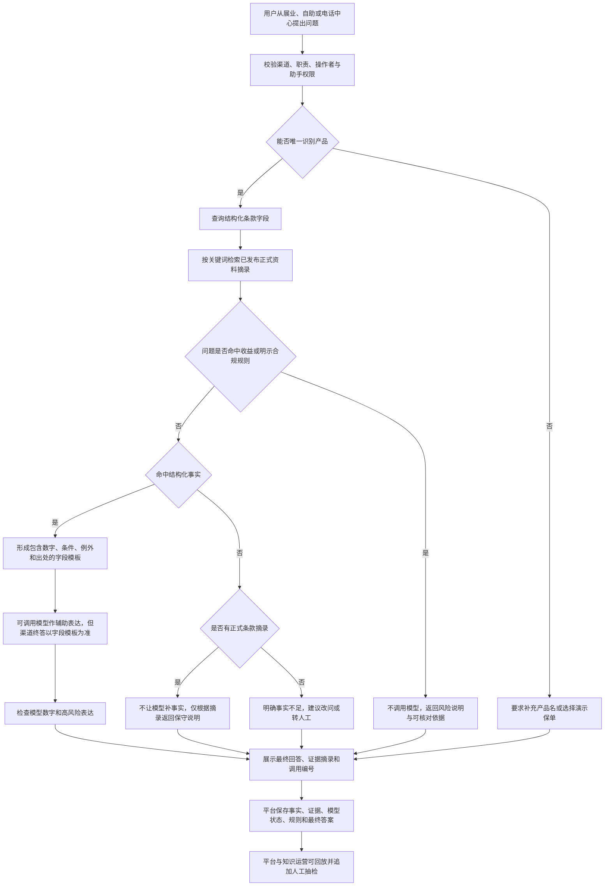

# 《条款可溯源寿险智能辅助平台——项目完整介绍与方案说明》

> 本文面向刚加入项目、尚不了解保险业务和人工智能技术的队友。阅读目标不是学会维护代码，而是能够准确回答五个问题：我们为什么做这个项目、平台具体做什么、不同角色怎么使用、系统为什么能够工作，以及当前已经做到什么程度。
>
> 本文以当前原型的实际功能为准。文中的“已经实现”均有现有页面或运行逻辑支撑；“未来可扩展”不代表当前已经上线。

---

## 第一章 项目背景——为什么需要这个平台？

### 1.1 先了解寿险业务在做什么

寿险并不只指“人去世后赔钱”的保险。广义的人身保险还包括重大疾病保险、医疗保险、养老年金保险、意外伤害保险等。不同产品解决的问题不同：

- 终身寿险主要围绕身故保障、现金价值和长期保单权益；
- 重大疾病保险主要围绕约定疾病、等待期、给付条件和给付次数；
- 医疗保险主要围绕医疗费用范围、免赔额、赔付比例和医院范围；
- 养老年金保险主要围绕领取年龄、领取方式、保证领取和红利等内容。

一款寿险产品从设计到长期服务，通常会经过产品设计与备案、销售说明、投保、核保、承保、保全服务、客户咨询和理赔服务等环节。客户可能在购买前询问“这款产品保什么”，也可能在持有多年后询问“我这张旧保单适用哪版条款”。因此，保险机构面对的不是一次性问答，而是贯穿较长合同周期的知识服务。

在这些环节中，保险条款是最重要的合同依据之一。营销员、客服人员、知识运营人员和客户，都可能需要从几十页甚至上百页的条款中找到一个具体事实，例如等待期、减保规则、领取年龄或责任免除。

### 1.2 保险条款为什么难读

保险条款不是普通的产品说明书，而是带有严格条件的合同文本。一个结论往往同时依赖以下信息：

- 问的是哪一家公司的哪一款产品；
- 使用的是哪个条款版本；
- 涉及哪一项保险责任；
- 什么事件触发这项责任；
- 是否存在等待期、年龄或医院范围等限制；
- 是否存在意外原因不适用等待期等例外；
- 最终结论的原文出处在哪里。

也就是说，条款中的数字不能脱离条件单独理解。“90天”“20%”“55周岁”看起来都是简单数字，但它们分别可能表示等待期、每年减保上限和女性养老金起领年龄。数字正确，不代表回答完整；产品正确，也不代表版本和适用条件正确。

### 1.3 一个典型问题：只回答“90天”为什么不够

假设客户问：

> “这款保险等待期是多久？等待期内出险能赔吗？”

如果系统只回答“等待期是90天”，至少还缺少四层信息。

第一，必须知道客户问的是哪款产品。不同产品的等待期可能不同，有些产品甚至没有同一种等待期设计。

第二，必须知道客户问的是哪项责任。重大疾病、医疗费用或意外责任的适用规则可能并不相同。

第三，“等待期内出险”这个说法仍然太模糊。是疾病确诊、住院、身故，还是意外伤害？不同事件可能对应不同处理方式。

第四，还要核对例外。以当前原型收录的中宏健康双星条款样例为例，结构化资料记录等待期为90天，同时记录因意外伤害导致的情形不适用该等待期。完整回答至少应说明：

> 该产品相关条款样例中的等待期为90天；因意外伤害导致的情形不适用该等待期。具体是否属于保险责任，仍需结合事故原因、责任条款、保单状态和实际材料判断，不能仅凭等待期数字认定一定赔付。

这就是本项目的出发点：保险问答的关键不是让语言听起来流畅，而是保证产品、数字、条件、例外和出处能够对应起来。

### 1.4 不同角色分别遇到什么问题

#### 营销展业人员

营销人员经常在较短时间内回答客户对产品的追问，例如：

- 什么时候可以减保？
- 每年最多减多少？
- 养老金从几岁开始领取？
- 分红是不是保证的？
- 这款产品和另一款产品有什么区别？

他们的困难不是完全不知道答案，而是需要快速找到适用于当前产品的准确口径，还要避免把复杂条件压缩成过度承诺。

#### 客服和电话坐席

客服人员面对的可能是存量客户。客户只说“我以前买的那款保险”，坐席就必须先确认产品和保单信息，再回答条款问题。若直接拿当前在售产品的条款解释旧保单，可能出现版本错用。电话服务还要求不同坐席尽量使用一致的事实基础，并在不能确认时及时转人工核对。

#### 客户

客户通常不会使用“责任免除”“保单年度”“现金价值”等专业术语。他更可能说：

- “生病了要等多久才开始赔？”
- “急用钱时能不能取出来？”
- “我住院了应该准备什么？”
- “是不是买了就一定赔？”

客户需要的是容易理解的说明，但“容易理解”不能以省略重要条件为代价。

#### 知识运营与平台管理人员

他们需要维护的不是单次答案，而是底层知识和使用规则。他们关心：

- 一条事实来自哪份资料；
- 哪些岗位有权调用哪个助手；
- 三个业务入口是否共用同一口径；
- 哪次回答被合规规则拦截；
- 模型失败后系统返回了什么；
- 人工抽检如何处置，而且不能篡改当时的原回答。

### 1.5 传统方法各有什么局限

#### 人工查阅完整条款

人工查阅的优点是依据明确，缺点是速度慢、专业门槛高，而且同一个事实可能被不同人员重复查找和整理。面对现场咨询时，营销人员和客服人员很难每次都完整阅读长篇条款。

#### 关键词搜索

关键词搜索可以迅速找到包含“等待期”的段落，但“找到相关段落”不等于“形成完整答案”。一段文字可能只出现90天，意外例外却在下一句或另一个位置。搜索结果仍然需要人工判断条件和上下文。

#### 固定FAQ

FAQ适合高频、稳定的问题，但客户问法很多，维护工作容易重复。产品改版后，多个渠道中的FAQ可能需要同时修改，否则会出现口径分叉。

#### 普通AI客服

大语言模型擅长理解自然语言和组织表达，但它是根据语言规律生成内容，不是保险合同数据库。它可能：

- 把其他产品的数字带入当前产品；
- 忽略等待期的例外；
- 在证据不足时补出一个“听起来合理”的答案；
- 把“可以申请”说成“一定获赔”；
- 把分红演示说成保证收益。

这些错误在一般聊天中可能只是“不准确”，在保险销售和服务中却可能造成误导。

### 1.6 我们希望解决的问题

本项目希望建立一套更稳妥的寿险智能辅助方式：

1. 先明确产品和问题类型；
2. 优先查询已经整理好的结构化条款事实；
3. 同时保留相关资料摘录和出处；
4. 让大语言模型承担语言理解和表达辅助，而不是随意决定合同事实；
5. 对数字和高风险表述进行检查；
6. 证据不足时澄清、返回原文或拒绝补充事实；
7. 将不同业务入口的调用统一留痕，供平台人员查看和抽检。

平台的目标不是代替保险机构作出承保、核保、理赔或法律判断，而是帮助使用者更快、更一致、更有依据地理解和传递条款事实。

---

## 第二章 项目概述——我们究竟做了什么？

### 2.1 用一段话介绍项目

“条款可溯源寿险智能辅助平台”是一套围绕寿险条款知识构建的本机演示原型。它为营销展业、客户自助和电话中心提供三个业务入口，在后台使用同一套结构化条款资料、原文摘录、智能辅助和风险检查能力；同时提供知识管理、智能体管理、职责授权、调用记录和质量抽检等平台侧功能。

它不是一个只会聊天的保险机器人。前台回答只是用户看到的最后一步，背后还有产品识别、事实查询、证据定位、规则检查、权限控制和调用留痕。三个入口不是三个互不相关的聊天窗口，而是同一平台能力在不同业务场景中的不同呈现。

### 2.2 项目的完整定位

本项目定位为：

> 面向寿险展业、客户服务和知识运营的条款智能辅助平台，以可核验的结构化事实和条款证据约束回答，并通过统一平台管理多个业务入口、智能辅助角色和调用记录。

这里有四个关键词。

**寿险条款**说明项目聚焦的是可回到合同文本核验的知识，不试图覆盖保险公司的全部经营活动。

**智能辅助**说明系统帮助人查找、解释和复核，不代替人作出正式业务决定。

**可溯源**说明回答不能只有结论，还要尽可能带回产品、字段、条款位置或资料摘录。

**平台**说明项目不只包含问答页面，还包括知识、智能体、权限、运行记录和抽检治理。

### 2.3 平台主要面向哪些用户

当前原型按照职责区分使用者。

- 营销展业：查询产品事实、对比部分结构化字段、获得带依据的解释；
- 客户自助：用更简明的方式咨询条款，并在需要时登记转人工；
- 电话外呼：生成沟通话术草稿，但不真实拨号；
- 电话坐席：把已经写好的通话转写内容提交给平台，获得旁侧提示；
- 通话质检：检查话术中的明显风险，不处理真实录音；
- 客户服务：查看转人工记录并核对条款或材料说明；
- 核保作业：只整理资料缺项，不给出承保通过、加费、除外或拒保结论；
- 理赔作业：只提供资料和下一步提示，不认定必赔，也不支付赔款；
- 培训：通过陪练和风险提示帮助工作人员练习；
- 平台与知识运营：维护智能体和资料范围、查看全量调用、进行抽检处置。

原型中的职责选择器用于演示权限差异，不是生产环境的账号登录系统。

### 2.4 平台能够完成哪些任务

围绕当前主线，平台能够完成以下任务：

1. 查询四份公开条款结构化样例中的部分产品信息、保险责任和责任免除；
2. 回答等待期、犹豫期、减保、保单贷款、养老金起领年龄、重疾给付次数等已经结构化的事实；
3. 对“哪款减保最早”“哪款写有转换年金”等有限问题进行程序化比较；
4. 将字段结果与相关资料摘录一同展示；
5. 对收益率、保证赔付、保证收益、与存款理财不当比较、夸大贬低等问题采取限制或拦截；
6. 在未唯一识别产品时要求用户补充产品名，避免默认混合多款产品；
7. 在渠道问答没有结构化事实和正式条款摘录时，不调用模型补写保险事实；
8. 为客户自助记录转人工事项；
9. 保存调用编号、问题、答案、摘录、模型状态、匹配事实、数字检查结果和规则类别等信息；
10. 允许平台与知识运营人员对调用追加“确认违规”“误报”或“需补知识”的抽检处置，同时保持原回答不变。

### 2.5 平台由哪些部分组成

可以把平台理解为四个互相连接的部分。

#### 第一部分：业务入口

包括代理人移动展业、客户自助和电话中心。不同入口的表单、语言风格和可用助手不同，但都把请求交给平台服务，不直接连接大语言模型。

#### 第二部分：条款知识

当前主线收录四份公开条款的结构化样例：

- 中英人寿鑫悦未来5号（至臻版）终身寿险（分红型）；
- 海港金彩颐年悦享版养老年金保险（分红型）；
- 中宏健康双星守护版重大疾病保险；
- 中国人民财产保险股份有限公司住院医疗保险（2024版）（互联网专属），仅作对照。

系统将产品信息、保险责任和责任免除整理到可查询的数据中，并保留来源说明和条款位置。系统中另有明确标注为虚构或研究草案的早期演示资料，它们不能被解释为真实在售产品。

#### 第三部分：智能辅助能力

平台按职责设置保障需求顾问、产品对照助手、条款客服、理赔引导、培训陪练、外呼话术助手、核保辅助和会话质检等角色。它们共用基础模型和知识能力，但职责、可访问资料和回答边界不同。

平台侧还有知识治理、运行观测、抽检研判、授权编排和口径中枢五个治理角色。这些角色主要用于说明或汇总平台状态，不是能够自主修改系统的“虚拟管理者”。

#### 第四部分：平台治理

平台与知识运营人员可以查看智能体广场、已发布知识、职责授权、渠道调用和抽检记录。治理能力保证“谁可以用什么”“回答依据是什么”“出现问题后怎样复核”不被隐藏在聊天界面之后。

### 2.6 AI在平台中承担什么职责

AI主要承担三类工作：

- 理解用户的自然语言表达，例如把“等多久才开始赔”联系到等待期；
- 在允许调用模型的场景中，根据已提供的资料摘录组织容易理解的回答；
- 根据不同智能辅助角色的职责，调整回答角度，例如客服解释、外呼草稿或培训陪练。

AI不负责决定正式保险事实。渠道主路径会先查结构化字段；如果命中字段，最终答案使用字段模板，模型润色不覆盖该事实。产品不能唯一识别、明确命中合规规则或没有可核验事实时，系统会跳过模型或限制回答。

### 2.7 平台和普通保险问答机器人有什么区别

普通问答机器人通常围绕“用户提问—模型回答”展开，本项目则围绕“问题—产品—事实—证据—表达—检查—记录”展开。

普通机器人关注回答是否流畅，本项目还关注：

- 回答属于哪款产品；
- 数字是否来自本次字段或摘录；
- 条件和例外是否一并带出；
- 回答是否出现保证赔付或保证收益；
- 当前职责是否有权调用该助手；
- 回答和证据是否能够通过调用编号回看；
- 抽检结论是否在不修改原回答的前提下追加保存。

因此，聊天是界面形式，知识和治理才是平台主体。

### 2.8 用户最终获得什么体验

对于业务人员，理想体验不是阅读数据库字段，而是输入一个自然语言问题，看到一段简明回答，并能展开查看条款依据。

对于客户，界面尽量隐藏内部治理细节，只展示需要理解的内容、来源和转人工入口。

对于平台人员，同一条调用会显示更完整的信息，例如业务入口、职责、智能体、匹配事实、资料摘录、模型是否被采用、规则命中和抽检状态。

这体现了“同一事实，不同视图”：不同角色看到的信息深度不同，但底层事实来源不能彼此冲突。

展示页还有一个数字导览形象「溯溯」。它由盾牌、条款页和放大镜组成，用来帮助第一次接触项目的人理解“有边界、找原文、核数字、留记录”这条主线。溯溯可以切换工作提示，并带人进入四个入口；它不是独立大模型，也不会自主作出保险判断。

四个入口用同一套“现场任务—系统动作—业务输出”说明具体用途：

- 展业：核对减保时点和限额，输出适用条件与条款位置；
- 客户自助：解释等待期与意外例外，高风险追问转为边界说明或人工处理；
- 电话中心：分别生成外呼草稿、坐席提示和独立质检结果；
- 智能体平台：汇总调用，定位证据，追加抽检并保留历史回答。

---

## 第三章 平台主要功能与业务场景

### 3.1 营销展业辅助

#### 使用者是谁

主要使用者是营销展业人员。当前页面采用移动端样式，用虚构客户和演示保单说明系统如何嵌入展业场景。

#### 他遇到什么问题

营销人员需要在客户沟通中快速核对产品事实。常见问题包括减保、等待期、贷款比例、养老金领取年龄和分红边界。传统做法可能需要翻阅条款、询问后台或查找培训资料，耗时且容易出现不同人员口径不一致。

#### 使用什么功能

展业人员可以选择虚构客户或演示保单，输入产品问题。若演示保单已经关联某份公开条款样例，系统会把该产品作为查询焦点；如果没有关联，用户需要在问题中明确产品名。展业入口只能调用获得授权的展业类智能辅助角色。

#### 平台如何处理

平台先识别产品，再查询结构化字段。对“哪款减保最早”等明确比较题，系统按字段直接计算，不让模型临时报数字。回答同时附带字段证据或相关条款摘录。若询问收益率，系统不会在对话中提供具体收益数字，而是提示利益演示不代表保证利益。

#### 最终获得什么结果

展业人员获得一段可以继续解释的条款事实、相关出处和调用编号。系统不替营销人员完成销售，也不把演示保单说成真实公司承保。

#### 完整案例

客户问：“中英鑫悦未来什么时候能减保，一年最多减多少？”

系统识别到“中英鑫悦未来”，匹配“减保起始”和“减保年度上限”两个结构化字段，生成字段模板，并附上公开条款样例的来源。营销人员看到的重点不是一个孤立比例，而是“从什么时候开始”和“每个保单年度上限”两个条件组合。

如果客户继续问“是不是比银行存款划算”，系统会触发与存款或理财不当比较的规则，不让模型顺着问题作收益承诺。

### 3.2 客户自助服务

#### 使用者是谁

主要使用者是希望自行了解保单或条款的客户。当前自助入口是原型页面，不是真实微信公众号或保险公司客户中心。

#### 他遇到什么问题

客户通常不知道专业字段名，也未必能准确说出产品全称。他可能说“这款要等多久”“是不是一定赔”“住院需要什么材料”。系统既要理解口语，又不能因为追求简洁而省略关键条件。

#### 使用什么功能

客户输入问题，可以选择当前演示上下文。自助入口使用条款客服或理赔引导等客户可见助手。回答后，客户可以登记转人工。

#### 平台如何处理

平台首先确认能否唯一识别产品。如果没有产品名，也没有演示保单提供产品焦点，系统会要求补充，而不是把多款产品混在一起回答。

若匹配到结构化事实，平台返回字段事实和出处；若未命中结构化字段但找到了正式条款摘录，渠道主路径只转述摘录，不调用模型补充新的保险事实；若两者都没有，则明确说明事实不足。

当客户说“是不是一定能赔”时，系统会命中承诺赔付规则，模型正文不作为结论，并提醒实际赔付需要根据完整合同、事故情况、保单状态和理赔审核判断。

#### 与传统FAQ有什么区别

FAQ要求客户的问题与预设问法比较接近。本平台可以接受较自然的表达，并将部分口语同义词映射到条款概念。例如“等多久”可以帮助定位等待期，“取钱”可以帮助定位减保。

但当前系统并不是无限理解自然语言。产品识别、事实匹配和合规检查仍以明确别名、关键词和词表为主，隐晦表达可能需要人工确认。

#### 完整案例

客户问：“中宏健康双星生病了要等多久？意外也要等吗？”

系统识别产品与等待期事实，返回90天，并同时带出“因意外伤害导致的情形不适用该等待期”和条款位置。客户得到的是“数字+例外+出处”，而不是只有“90天”。

如果客户继续问“那我这次肯定能赔吧”，系统不会给肯定答复。客户可以点击转人工，系统保存本次调用编号和问题，客户服务岗能够看到待处理记录。这个动作只是登记，不会打开微信或真实客服工单系统。

### 3.3 电话中心辅助

#### 使用者是谁

当前电话中心页面面向电话外呼、电话坐席和通话质检三类职责。它们在同一页面中切换，但服务端会检查当前职责是否与提交区域相符。

#### 实际业务中的工作流程

真实电话中心通常包括来电接听、客户身份核验、语音或文字转写、知识查询、话术提示、工单流转和事后质检。本项目没有完整接入这些生产系统，而是选择其中可演示的“文字辅助”部分。

#### 平台如何辅助

- 外呼：根据目标和资料生成沟通草稿，只说明身份、资料边界和需要核实的问题；
- 坐席：坐席将已经写好的转写文本贴入页面，平台查询条款并给出旁侧提示；
- 质检：对一段话术检查明显的承诺、收益保证或贬低用语，另存一条质检结果。

三个区域使用同一知识基础，因此等待期、减保等事实不需要在电话系统里另维护一份。

#### 出现不确定问题时如何处理

无法确认产品时，平台要求补充产品；事实和正式摘录都不足时，平台不补写保险结论；涉及赔付、承保或正式受理时，提示转入人工或正式业务流程。

#### 当前原型和真实电话系统的区别

当前原型：

- 不拨打电话；
- 不接收真实来电；
- 不进行语音识别；
- 不保存真实通话录音；
- 不连接保险公司的呼叫中心、客户系统或工单系统；
- 质检对象是输入的文字，不是自动分析全部通话。

因此，它证明的是“统一条款能力可以怎样支持电话场景”，不是已经完成电话中心生产集成。

### 3.4 智能体平台与知识运营

#### 为什么前台问答背后还需要平台

如果每个业务入口各自维护资料、提示词和答案，同一问题很容易出现三个口径。条款更新后，还需要逐个系统修改。统一平台的作用是把知识、职责、助手和调用记录集中起来，让业务入口共享底层能力。

#### 智能体广场

智能体广场以卡片展示不同辅助角色。保险主线包括保障需求顾问、产品对照助手、条款客服、理赔引导、培训陪练、外呼话术助手、核保辅助和会话质检；平台侧还有五个治理角色。

广场中的“加入团队”只是当前浏览器中的个人收藏，不是多人协作或组织级部署。系统另有三名综合职能演示助手，但它们只读取虚构制度资料，不是本项目的保险核心创新，也不连接真实OA、HR或IT工单系统。

#### 知识管理

知识按来源区分公开条款、虚构演示资料、外部对照和早期研究，避免把不同性质的材料混成“公司知识库”。公开条款样例保留真实公司名和产品名；虚构材料明确标注虚构；早期骑安心研究资料不作为当前三个渠道的默认主线。

系统支持导入UTF-8文本、Markdown、DOCX和文字型PDF，并保存分段和版本。当前不支持扫描件OCR，也不是自动构建向量知识库。

#### 授权

不同职责只能调用获得授权的助手。权限控制不仅体现在按钮是否显示，服务端也会拒绝跨职责提交或越权读取全量调用。

例如：

- 客户只能使用客户自助入口；
- 营销展业不能查看全量渠道调用；
- 业务岗位不能使用中台治理角色；
- 只有平台与知识运营可以新建对话智能体、配置资料范围和查看全量调用。

#### 运行观测和调用记录

每次渠道提问会记录调用编号、渠道、职责、操作者、上下文、演示保单、所用助手、问题、最终回答、资料摘录、模型状态、耗时和规则类别。最新链路还保存匹配事实、条款位置、模型原始输出、数字检查和最终采用状态等追踪信息。

调用记录的价值不只是统计次数，更重要的是回答出现问题后能够追问：

- 当时问了什么；
- 识别了哪款产品；
- 命中了哪些结构化事实；
- 给模型看了哪些证据；
- 模型输出是否被采用；
- 为什么被拦截或降级；
- 最终向用户显示了什么。

#### 质量抽检

平台人员可以对一条调用追加三种处置：

- 确认违规；
- 误报；
- 需补知识。

处置只追加到抽检记录，不修改当时的原回答。这一点很重要：如果复核后直接覆盖原答案，就无法知道系统当时究竟说过什么，也无法客观分析问题来自知识、模型还是规则。

---

## 第四章 核心技术原理——平台为什么能够工作？

### 4.1 大语言模型：会组织语言，但不等于掌握合同事实

大语言模型可以理解为一个经过大量文本训练的语言生成系统。它会根据当前问题和上下文，预测接下来最合适的文字，因此擅长总结、改写、解释和对话。

例如，把条款中的正式表述改写为客户容易理解的话，大语言模型通常比固定模板更自然。

但模型并不是从保险合同数据库中“读取真相”。当上下文不足时，它仍可能生成语法流畅、逻辑看似合理的内容，这类现象通常被称为“幻觉”。在保险场景中，幻觉可能表现为编出一个等待期、混入其他产品的比例，或者把“可能符合申请条件”说成“一定能赔”。

因此，本项目把模型放在事实查询之后。模型可以帮助表达，但合同事实首先由结构化字段和资料摘录提供。

### 4.2 检索增强生成：先查资料，再组织回答

检索增强生成通常简称RAG。可以把它理解为“开卷回答”：

1. 用户提出问题；
2. 系统先从知识资料中查找相关内容；
3. 将查到的内容连同问题一起交给模型；
4. 模型尽量依据这些资料回答。

相比完全依赖模型记忆，RAG可以降低无依据回答的风险。

但RAG也不是只要“搜到一段话”就万事大吉。检索到相关段落后，模型仍可能遗漏条件、错误组合数字或引用不完整。因此，本项目在资料摘录之外，又增加了结构化字段优先和数字支持检查。

需要特别说明：当前项目采用的是**结构化字段查询与关键词资料检索结合**的方案，不是向量RAG。关键词检索根据问题中的中文词组和字母数字内容，对已发布资料段落进行计分并选取相关片段。项目没有实现文本向量库、语义向量召回或重排序模型。

### 4.3 结构化保险条款：把长合同整理成可核验事实

如果每次提问都让模型重新阅读整份长条款，会有三个问题：

- 计算和调用成本较高；
- 同一事实可能在不同问法下被模型提取成不同结果；
- 条件、例外和出处难以稳定绑定。

结构化的思路，是把高频且高风险的事实提前整理出来。例如，一条等待期事实可以包含：

- 产品标识；
- 事实名称：等待期；
- 数值：90天；
- 例外：因意外伤害导致的情形不适用；
- 条款位置：2.3.1；
- 来源文件。

当前原型把公开条款样例整理为产品信息、保险责任和责任免除三类数据。运行时会根据问题关键词组合出事实句。它已经能够支持部分字段查询，但还不是完整的通用“事实单元数据库”：产品多版本、复杂条件关系和主附险关系仍需后续建设。

### 4.4 证据约束与可溯源回答

可溯源回答的基本要求是：使用者不仅看到“系统说了什么”，还能够知道“系统为什么这样说”。

当前平台使用两类证据：

- 字段证据：结构化事实及其条款位置或产品信息来源；
- 资料摘录：从已发布资料中检索到的相关原文片段。

以等待期为例，回答中的90天和意外例外来自同一条结构化事实，证据中保留产品名和条款位置。这样，知识运营人员可以回到对应资料检查。

证据约束还包括三个重要思想。

**条件完整性**：不能只保留数字，还要尽量保留触发条件和例外。

**来源匹配**：不能用A产品的摘录回答B产品的问题。

**数字支持检查**：模型生成句中的阿拉伯数字、小数或百分号表达，必须在本次字段或摘录中出现，否则模型句会被放弃。

当前数字检查是字符级检查。它能发现“证据中是90天，模型却写120天”这类明显问题，但不能理解“90天”和“90岁”的单位差异，也不能自动把“百分之八十”转换为“80%”。因此，它是一道低成本保护线，不是完整的数值推理系统。

### 4.5 AI Agent与智能体平台

“AI Agent”通常译为“智能体”。广义上，它指能够围绕目标感知信息、调用工具并采取行动的AI系统。有些高级智能体可以自己拆解任务、规划步骤、反复调用工具，甚至在一定范围内自主执行。

本项目中的智能体更准确地说是**角色化智能辅助能力**。不同角色有不同的职责、可用资料、回答边界和入口授权。例如：

- 条款客服负责用通俗语言解释已发布资料；
- 外呼话术助手只生成话术草稿；
- 核保辅助只整理缺项；
- 会话质检只指出风险用语；
- 口径中枢说明三个入口应共用哪些字段。

这些角色共用基础模型和平台能力。它们不是各自训练的一套模型，也不会自主开会或自行修改知识库。渠道主路径按照固定程序执行产品识别、字段查询、资料检索、规则检查和记录。

“智能体平台”强调的是统一管理：不同角色在同一个平台中被配置、授权、调用和观察，而不是简单堆叠多个聊天窗口。

### 4.6 合规检查与风险控制

保险回答需要特别谨慎，因为客户可能把辅助说明理解成正式承诺。当前平台从输入和模型输出两侧检查四类明示风险：

1. 承诺赔付或承保，例如“一定能赔”“保证承保”；
2. 保证收益，例如“红利肯定有”“稳赚不赔”；
3. 与存款或理财不当比较，例如“比存银行划算”；
4. 夸大或贬低，例如“全市场第一”“别家都不如”。

如果用户问题已经命中这些规则，渠道主路径会跳过模型，直接返回风险说明和可核对摘录。若模型输出命中规则，模型正文不会作为结论。

平台还对职责权限、产品澄清、无证据回答和人工抽检进行控制：

- 产品不明确时先澄清；
- 字段和正式摘录都不足时拒绝补充保险事实；
- 业务岗位不能越权查看全量调用；
- 抽检只追加处置，不修改原答案。

当前合规能力主要基于明确词表，不是完整的语义合规模型。同义改写、多轮诱导和复杂语境仍可能漏判，必须保留人工复核。

---

## 第五章 完整工作流程——用户提出一个问题后发生了什么？

下面以渠道入口中的问题为例：

> “中宏健康双星的等待期是多少天？因意外事故也要等吗？”

### 5.1 完整流程图

### 5.2 第一步：从业务入口接收问题

用户可能来自展业、客户自助或电话中心。请求中不仅包含问题，还包含渠道、职责、操作者编号、上下文编号和可选的演示保单。

这些信息用于判断：

- 当前职责是否可以使用这个入口；
- 当前助手是否获得该职责授权；
- 是否有演示保单为产品识别提供焦点。

页面不直接调用大语言模型，而是把请求统一提交给平台服务。

### 5.3 第二步：识别保险产品

系统根据问题中的产品别名识别产品，例如“中宏”“健康双星”会指向中宏健康双星；演示保单也可以关联一份公开条款样例。

如果用户没有点名产品，也没有选择带产品关联的演示保单，系统不会默认把全部主产品混在一起，而是要求补充产品信息。

明确的跨产品比较是例外。例如用户问“哪款减保最早”，系统会进入受支持的比较逻辑，对主产品的相关结构化字段进行程序计算。

### 5.4 第三步：查询结构化条款字段

产品明确后，系统根据问题关键词匹配结构化事实。

对于本例，问题中出现“等待期”和“意外”，系统匹配等待期事实，得到：

- 等待期：90天；
- 例外：因意外伤害导致的情形不适用该等待期；
- 条款位置：当前样例记录的位置；
- 产品与来源文件。

系统将它们组成一个字段模板。模板不是模型临时编写的，而是由已经整理的字段生成。

### 5.5 第四步：获取资料摘录和出处

系统还会在该助手允许访问的已发布资料中进行关键词检索，选择相关段落作为补充证据。字段证据和资料摘录会一同进入本次调用记录。

当前检索是关键词计分，不是向量语义搜索。它适合当前小规模、字段明确的样例，但面对更大知识库时仍需扩展。

### 5.6 第五步：判断是否调用大语言模型

不是所有问题都调用模型。

以下情况会跳过模型：

- 产品无法唯一识别，需要澄清；
- 问题命中收益限制或明示合规规则；
- 渠道主路径未命中结构化事实；
- 平台治理角色可以直接根据留存数据形成确定性说明。

渠道主路径命中结构化事实时，系统可以调用模型作辅助表达，但最终答案使用字段模板，模型润色不覆盖结构化事实。

非渠道的普通智能体对话路径在有证据时可以采用模型正文，但仍会经过规则和数字检查。这是当前两条路径的重要区别。

### 5.7 第六步：模型基于证据组织表达

如果允许调用，模型会收到：

- 当前助手的职责和回答边界；
- 用户问题；
- 已检索的资料摘录；
- 必要的上下文。

模型的任务是把已有材料组织得更容易理解，而不是自行补充条款事实。

### 5.8 第七步：数字和合规检查

系统检查模型输出是否出现：

- 字段或摘录中不存在的阿拉伯数字、比例；
- “一定赔”“保证收益”等明示风险表达。

检查不通过时，模型正文被放弃或隐藏，系统改用字段模板、资料摘录或风险提示。

在本例中，即使模型把90天误写成120天，120不在本次证据中，模型句也不会成为渠道终答。

### 5.9 第八步：证据不足时怎样处理

系统按不同情况处理，而不是统一让模型“试着回答”。

- 产品不明确：要求补充产品名；
- 有正式条款摘录但无结构化事实：根据摘录给出保守说明，不调用模型补事实；
- 字段和正式摘录都没有：明确说明事实不足；
- 涉及具体承保或赔付判断：提示进入正式业务流程或转人工；
- 客户自助需要人工服务：登记转人工记录。

### 5.10 第九步：向用户展示结果

最终页面展示：

- 回答正文；
- 相关资料摘录和来源；
- 模型是否被采用或系统是否使用字段结果；
- 调用编号；
- 必要的边界说明。

不同入口的展示方式不同，但底层事实和出处来自同一平台。

### 5.11 第十步：保存调用并支持抽检

平台保存本次问题、匹配产品、结构化事实、证据、模型输出、数字检查、规则类别、最终答案和调用编号。

平台与知识运营人员之后可以按渠道或调用编号查看记录。如果发现问题，可以追加“确认违规”“误报”或“需补知识”。原回答保持不变，以便后续分析和复盘。

---

## 第六章 平台的创新点与核心价值

### 6.1 从“让模型回答”转向“让事实先确定”

普通AI问答常把模型放在中心位置：模型读取问题和材料后直接给结论。本项目把可确定的条款事实放到模型之前。

这样设计的价值在于，高风险数字和条件不必每次依赖模型重新提取。等待期、减保起始年度、领取年龄等事实可以被多个入口复用。模型供应商更换时，底层事实也不需要随之重建。

### 6.2 从“附一段引用”转向“事实与证据对应”

普通RAG可能只在回答末尾附一个文档链接，但链接无法说明具体哪句话支持哪个结论。本项目尝试把字段、条件、例外和条款位置放在同一回答链路中。

这项设计的价值不是让页面显得更专业，而是方便业务人员和知识运营人员核对：90天从哪里来，意外例外是否存在，当前答案属于哪款产品。

### 6.3 三个业务入口共享统一能力

展业、客户自助和电话中心面对不同用户，表达方式可以不同，但条款数字和适用条件不能各说各话。

三个入口都调用同一平台服务，意味着：

- 条款事实只需维护一份；
- 合规规则可以统一执行；
- 调用记录能够集中查看；
- 新增入口时可以复用现有知识和治理能力。

预期上，这种设计能够减少重复维护和渠道口径分叉，但实际节省多少工时仍需通过真实机构试点验证。

### 6.4 将智能辅助和平台治理放在一起

如果只有前台问答，系统出现错误后很难知道原因。项目把知识、授权、调用和抽检纳入同一个平台：

- 知识管理回答“依据在哪里”；
- 授权回答“谁可以使用什么”；
- 调用记录回答“当时发生了什么”；
- 抽检回答“人后来如何判断”。

这让AI不再是一个看不见内部过程的黑箱，而成为可以被业务人员监督的辅助工具。

### 6.5 结构化事实与生成模型互补

结构化字段稳定、可计算，但表达较机械；大语言模型表达自然、能理解口语，但可能不准确。两者结合的优势是：

- 程序负责可确定的数字和比较；
- 模型负责解释和对话；
- 原文摘录提供核对依据；
- 规则和人工复核处理高风险边界。

项目不是在结构化系统和大模型之间二选一，而是让它们各自承担更适合的工作。

### 6.6 对不同业务角色的潜在价值

对营销展业，平台旨在缩短查找条款事实的时间，并降低现场解释中遗漏条件的风险。

对客户服务，平台旨在提供相对统一的事实基础，并在信息不足时引导澄清或转人工。

对电话坐席，平台旨在提供带出处的旁侧提示，而不是让坐席完全依赖模型自由回答。

对知识运营，平台将一次性问答转化为可以复用、追踪和抽检的知识服务过程。

对合规和质检，调用记录和明示规则提供了初步抓手，但当前系统不能代替专业合规审查。

### 6.7 与常见方案的区别

#### 与传统知识库相比

传统知识库擅长文档、目录、权限和搜索。本项目进一步强调条款事实字段、业务入口调用和生成结果检查。它更适合作为保险条款专业能力层，与成熟知识库组合，而不是完全替代企业知识平台。

#### 与传统客服系统相比

传统客服系统擅长电话、工单、客户身份和服务流程。本项目不具备这些生产能力，而是提供可嵌入客服场景的条款查询和回答治理原型。

#### 与普通AI聊天机器人相比

普通聊天机器人以对话为中心，本项目以条款事实、证据和调用治理为中心。模型只是链路中的一个环节。

#### 与完整自主智能体相比

自主智能体可以自行规划和执行多步任务。本项目主要是固定流程和角色化辅助，不应将其描述为可以自主承保、理赔或运营保险公司的智能员工。

---

## 第七章 项目整体演示案例

下面设计一个适合队友讲解的完整演示故事。人物、客户和保单均为虚构演示情境，不代表真实保险公司承保或真实客户。

### 7.1 故事背景

虚构客户“客户-02”持有一张编号为“DEMO-02”的演示保单。演示保单关联中宏健康双星守护版重大疾病保险的公开条款样例，仅用于说明查询链路，不代表该保险公司为这名虚构客户承保。

客户最近听到“等待期”这个词，希望知道：

> “这款产品等待期多久？如果是意外事故，也要等吗？那是不是出了事就一定能赔？”

### 7.2 第一幕：营销展业人员现场核对

展业人员进入代理人移动展业入口，选择客户-02和DEMO-02，输入前两个问题。

平台通过演示保单关联识别中宏健康双星，查询结构化等待期事实，返回90天、意外伤害例外和条款位置。页面同时显示资料出处和调用编号。

展业人员据此向客户说明：系统能够核对等待期条款，但不能仅凭这一项事实判断具体事故一定获赔。

这一幕展示的是“自然语言问题如何回到结构化事实和出处”。

### 7.3 第二幕：客户自行咨询

客户回家后进入客户自助入口，再次询问：

> “那是不是出了意外就一定能赔？”

问题中的“一定能赔”命中承诺赔付规则。系统不调用模型给出肯定回答，而是提示不能把演示说明当成赔付决定，并展示可核对的资料。

客户仍有疑问，于是点击转人工。平台登记一条待处理记录，保留刚才的调用编号和问题。这里没有打开真实微信，也没有生成真实客服工单。

这一幕展示的是“客户自助如何处理高风险追问和转人工”。

### 7.4 第三幕：电话坐席辅助答复

客户之后通过电话咨询。演示中的坐席把一段已经写好的转写文本贴入电话中心坐席区：

> “客户想确认意外情况下是否不受90天等待期限制，并询问能否保证赔付。”

平台再次读取同一条款事实和出处，给坐席旁侧提示：可以说明意外伤害导致的情形不适用该等待期，但不能把等待期例外等同于保证赔付。坐席应继续核对责任范围、事故原因、保单状态和正式材料。

这一幕展示的是“电话坐席和展业入口如何共享同一事实基础”。

### 7.5 第四幕：质检发现风险表达

质检人员把一段不恰当话术提交到质检区：

> “这个情况不受等待期限制，所以一定能赔。”

系统识别到“一定能赔”，标记承诺赔付风险。质检结果作为新记录保存，不会改写坐席当时那次回答。

这一幕展示的是“风险发现和原始记录保留”。

### 7.6 第五幕：平台管理人员回放和抽检

平台与知识运营人员打开调用记录，按客户、渠道或调用编号查看整个过程。他可以看到：

- 展业入口问了什么；
- 客户自助是否触发合规规则；
- 电话坐席使用了哪些字段和摘录；
- 模型是否被调用或采用；
- 最终答案和条款位置；
- 是否发生转人工；
- 质检记录命中了哪类规则。

管理人员选择客户自助的高风险调用，追加“确认违规”或“误报”；如果发现资料本身缺少关键事实，则选择“需补知识”。所有处置都不修改原回答。

### 7.7 这个故事说明了什么

五个角色并没有各自维护一份等待期答案。他们使用同一平台中的同一结构化事实和条款出处，但界面和操作不同：

- 展业人员看到适合现场解释的事实；
- 客户看到简明说明和转人工；
- 坐席看到旁侧提示；
- 质检看到风险词；
- 平台人员看到完整调用链和抽检入口。

这就是项目的整体性：前台多入口、后台一套知识、统一风险控制和统一留痕，而不是几个孤立的聊天页面。

---

## 第八章 当前成果与未来发展

### 8.1 当前已经实现的主要功能

当前已经形成可在本机运行的Web原型，主要包括：

- 展业、客户自助、电话中心和智能体平台四个展示入口；
- 九条岗位职责和客户自助的服务端权限检查；
- 四份公开条款结构化样例；
- 部分条款字段查询与有限的跨产品程序比较；
- 关键词资料检索和证据摘录；
- 已配置的千问模型调用；
- 结构化字段优先的渠道回答；
- 明示四类合规规则；
- 字符级数字支持检查；
- 无证据时的澄清、摘录退路或事实不足提示；
- 客户自助转人工登记；
- 智能体广场、知识展示、授权和调用记录；
- 调用追踪与人工抽检，且抽检不修改原回答。

### 8.2 当前条款数据和演示范围

核心演示使用三份寿险主产品和一份医疗险对照样例。产品信息、保险责任和责任免除来自课程作业整理的公开条款结构化资料。

系统另有虚构公司、虚构客户、演示保单和早期研究资料，用于展示渠道、权限和知识边界。所有虚构资料均应保持明显标识，不能被介绍成真实客户、真实保单或真实在售产品。

### 8.3 现有评测能够支持什么结论

当前自建50题来自结构化字段及其口语改写，题目和标准答案共享同一事实源。最新重跑结果为：

- 只问模型：8/50；
- 模型加关键词检索：25/50；
- 模型加结构化字段查询：46/50；
- 不调用模型、只查结构化字段：50/50。

这些结果支持一个有限结论：在这组字段衍生题上，向回答链路提供结构化字段，比只依赖模型或关键词摘录更容易保持目标数字一致。

它们不能被解释为行业准确率，也不能证明系统面对未知产品、复杂条款或真实客户问题时达到同样效果。纯字段50/50主要说明字段题和字段答案一致，不代表模型能力。

CUFEInse公开产品对比小样本中有3道选项题，模型选择与标注一致3/3；其余开放题没有计算准确率。这同样只能作为小样本一致性观察。

### 8.4 当前原型的主要局限

当前项目仍是比赛和教学性质的本机原型，主要局限包括：

- 不是真实保险公司的生产系统；
- 没有真实账号认证、租户隔离和机构级权限体系；
- 没有接入真实展业App、微信公众号、电话网络、录音或工单系统；
- 不进行自动承保、核保、理赔或赔款计算；
- 没有实现扫描件OCR和向量检索；
- 结构化条款覆盖范围有限，复杂主附险、批单和特别约定关系尚未建模；
- 当前事实层还没有完整的同产品多版本查询机制；
- 合规检查主要依赖明示词表，不能覆盖所有同义改写和多轮语境；
- 数字检查不理解单位和数字语义；
- 现有50题不是独立测试集；
- 系统输出不能替代保险专业人员、合规人员或法律人员复核。

### 8.5 未来值得继续拓展的方向

后续发展应继续围绕“事实更完整、证据更可靠、使用更可控”，而不是单纯增加智能体数量。

#### 建设完整的产品版本治理

让同一产品的不同条款版本能够并存，查询时明确产品和版本，调用记录保存当时使用的版本，避免新资料覆盖历史口径。

#### 扩展条款事实模型

将主体、触发条件、例外、后果、责任关系和多段证据进一步结构化，支持主险、附加险、批单和特别约定之间的关系。

#### 改进检索能力

在保留结构化字段优先的基础上，评估向量检索、混合检索和重排序，使系统能够在更大规模资料中找到相关原文。实施后仍需验证“检索相关”是否真正支持最终事实。

#### 建设独立测试和合规对抗集

由不查看字段表的人员从原始条款独立命题，双人标注答案与出处；另建同义改写、多轮诱导和复杂语境的合规测试，分别统计事实、条件、例外、引用和风险识别表现。

#### 加强语义与数字校验

在字符检查之外，识别数字类型、单位、日期、比例和中文数字，判断数字是否被用于正确语境；同时研究规则、语义分类和人工复核的组合方式。

#### 开展真实机构小范围试点

在授权和脱敏前提下，从一款产品、一个渠道和一套独立测试开始，记录查询时间、知识维护工时、错误类型、人工复核和用户反馈。只有真实试点数据才能判断平台是否确实提高效率或降低风险。

### 8.6 队友介绍项目时应把握的边界

对外介绍时，可以说平台已经实现三个业务入口共享条款字段与证据、明示规则、调用记录和抽检。

不能说平台已经接入真实保险公司、完成生产部署、能够自主核保理赔、具备完整语义合规能力，或已经通过行业级准确率验证。

最准确的总结是：

> 本项目已经完成一套可运行的寿险条款智能辅助原型。它把结构化条款事实、原文证据、大语言模型和平台治理连接在同一条业务链路中，让展业、客户自助和电话中心能够共享相对统一、可回看的条款依据。项目当前证明的是技术路径和平台逻辑具有可演示性；面向真实保险业务的效果、完整版本治理和生产安全仍需要后续独立测试与机构试点。

