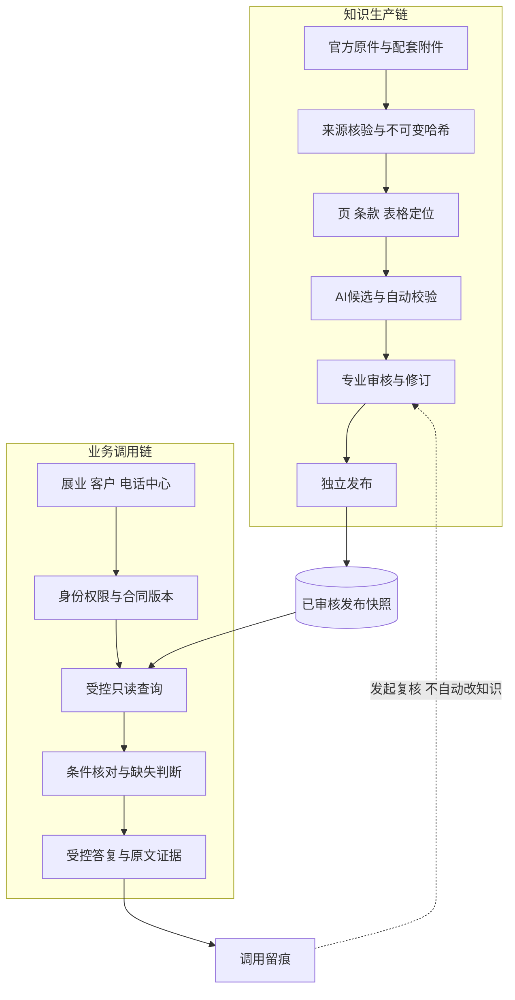

# 架构画图与技术答辩依据
## 图的层次
目标架构四层：业务入口→受控服务→统一知识底座→基础设施。逻辑分层不等于已部署微服务。当前实现是Python单体、SQLite、原生HTML/CSS/JS；当前原件以SHA-256为键存SQLite BLOB，独立对象存储、持久后台队列属于目标设计。

## 两条处理链
生产链：官方原件→来源与身份核验→逐页/条款/表格解析→AI候选→自动校验→专业审核→独立发布→发布快照。
调用链：岗位与问题→授权和产品版次→读取当前合法快照→条件核对与缺口判断→答案计划/受控模板→答复与证据→调用记录。
生产链的候选区不得直接连业务输出。复核反馈只进入待办，不自动改写正式事实。图上“发布”节点必须位于“专业审核”之后。

## 可直接重画的结构

## 当前代码对应
| 能力 | 文件或表 | 当前范围 |
|---|---|---|
| 产品和合同版次 | kg_product / kg_version | 结构化登记，合成与真实标签 |
| 不可变原件 | kg_asset / kg_material | SQLite BLOB、SHA-256、来源与附件关联 |
| 页及片段 | kg_page / kg_fragment | 物理页、印刷页、条款、文字区间 |
| 表格定位 | knowledge_tables.py | 网格坐标、行列标签、特定续表继承、不可覆盖任务结果 |
| 候选及引文 | knowledge_extract.py / kg_candidate / kg_evidence | Schema、字段、条件、例外、逐字引文、证据角色 |
| 审核修订 | kg_review / KnowledgeStore.review | 审批、拒绝、退修、错误分类、保留旧修订 |
| 发布回滚 | kg_release / kg_release_fact / kg_head | 事务快照、当前指针、合法历史证据复检 |
| 管理分岗 | knowledge_http.py | builder / reviewer / publisher本机角色令牌 |
| 业务读取 | app.py / static/classic/app.js | 新版国内展业显式选择版次和字段、只读发布快照 |
| 模型 | QwenAdapter | 真实配置未齐，尚未实测调用；注入响应用于合成测试 |
| 审计 | kg_audit及业务调用轨迹 | 本机角色、版本、快照和事实关联；非防篡改审计 |

## 目标能力与边界
- 自然语言任务理解、版次消歧、条件引擎、跨条款依赖执行、答案计划是完整方案设计，不能说已全量上线。
- 多端统一调用按阶段迁移，当前新路径先接展业。
- 无可靠原文时，缺证据不能用AI置信度代替；无候选不等于NA。
- 当前主要走文字PDF，未接OCR。网格解析不等于复杂语义与金额计算自动正确。
- 企业SSO、唯一人员账户、防篡改留存、队列与监控属于生产化演进。

## 技术壁垒的专业表述
壁垒来自保险事实建模、版本与证据约束、审核修订、复杂表格定位及长期维护的组合。通用模型和RAG本身不是独有壁垒；当前不宣称首创、专利、不可复制或成熟行业覆盖。
逐步积累：经授权的产品版本集、独立专业标注、条件例外字典、解析规则、错例库、冻结回归集、发布和调用记录。只有实际审核与使用后才能将“可积累”改为“已形成规模”。

## 发布前控制
来源与身份已确认；页和片段可定位；引文与原件哈希一致；字段证据同版；候选逐项专业批准；无未解决错误；发布角色受权；写快照后原子切换指针。审批、发布、回滚和查询均复检当前证据状态。
