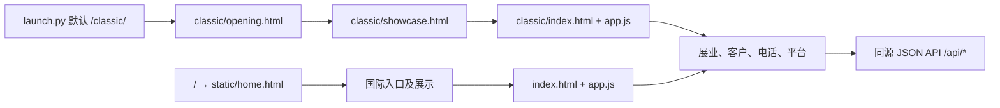
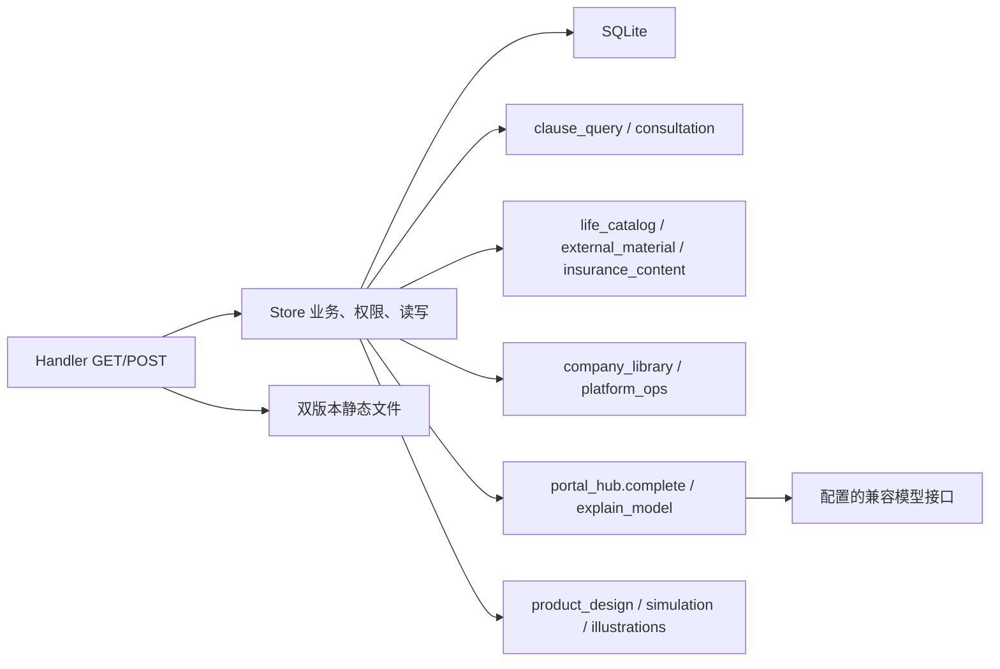
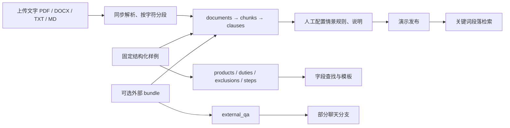
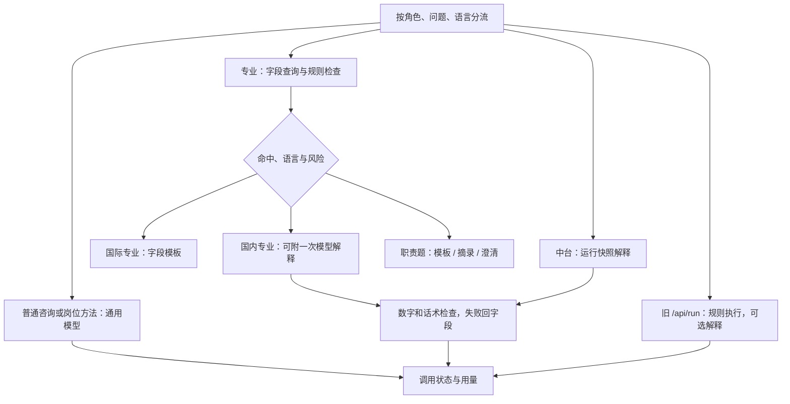
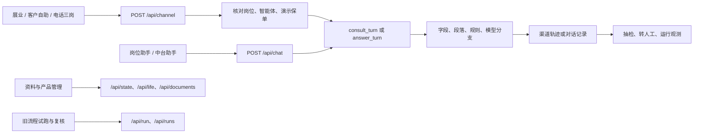

# 当前系统架构

基线为 ff00af0。图中节点对应实查代码。四层能力落在单个本地 Python HTTP 进程中。

## 1. 前端

定位：app.py:1656；static/app.js:16、81、250；static/classic/app.js:27、157、495。工作台通过 desk/page 参数和本地 state 渲染，英文版 API 加 X-Baosu-Lang: en。

## 2. 后端

定位：app.py:133、197、1608、1656、1762、1863。启动器负责端口与浏览器入口。Store 初始化会建表、备份、导入及同步，不能作为只读盘点入口。

## 3. 知识数据流

定位：app.py:92、335、450、466、517、581、677、1831。文档与字段两路使用同一数据库，审核和版本边界不同。利益演示走 illustrations.py，不进入上述字段检索。

## 4. AI 调用

定位：app.py:768、809、1111、1369、1561；portal_hub.py:362、383；clause_query.py:285。职责字段命中时即使尝试模型，也可能只采用模板。调用成功、最终采用与专业正确性是三个口径。

## 5. 业务端调用

定位：app.py:1005、1087、1179、1248、1322、1688、1807。电话、微信和保单均为演示业务上下文，未见真实外部渠道接入。完整性复核和 UI/API 兼容约定见 [前端计划](FRONTEND_UPGRADE_PLAN.md)。
