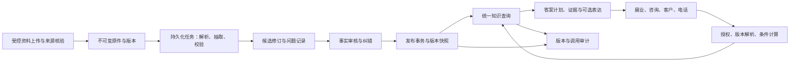

# 升级目标架构

首批沿用 Python、SQLite 和双版本原生前端。在单体内部划分加工、发布、查询三个接口边界。原件采用私有文件存储，SQLite 管理身份、证据定位、处理状态与发布快照。以养老年金试点验证整条链，再逐步覆盖既有产品。

| 边界 | 权限与接口 |
|---|---|
| 加工 | 上传者登记产品版本与来源。工作进程只写资产、解析和候选。审核者可提出修订或批准指定修订 |
| 发布 | 发布者只能选择已审、无阻塞、证据完整的修订。事务写入快照成员和审计后，原子切换产品版本的当前发布指针 |
| 查询 | 服务器根据身份、岗位、保单或显式选择解析产品版本；业务只从授权的已发布快照读取。内部检索 API 返回事实、条件、例外、证据和快照 ID |
| 兼容 | 保持 /api/channel、/api/chat、/api/life 现有协议。适配器继续组装 reply/evidence/trace 等字段，新增 knowledgeReleaseId 和结构化 evidenceRefs；旧资料保留演示标签，严格模式不回退到旧样例。原通用咨询、情景库、产品设计和利益演示保持独立语义 |
| 审计 | 记录处理/复核/发布 actor、动作、版本、时间和原因。调用记录存快照、事实、证据及回退状态，按权限回看 |

候选管理建议新增 /api/knowledge/v1 前缀，先落地资料、任务、审核、发布 API。业务查询先作为服务内函数，避免产生无授权的第二个读入口。列表分页，写入带幂等键或 expectedRevision，冲突用 409，越权按对象屏蔽，字段及状态不合法用 422。二进制通过单独的受权上传/原件读取处理。

应用通过产品与渠道开关选择新适配器。先影子运行并比对，经确认后才切换答案路径。发布回滚指向经过验证的上一快照，保留原快照和历史调用。若关闭新路径，严格模式拒答或转人工，演示模式可以恢复带演示标识的原路径。

SQLite 内的任务表和单工作进程足以验证试点。以积压、锁等待、恢复时间和并行需求判断是否加独立队列；结构化查询覆盖率不足时才评估全文检索。向量检索若采用，仅作受权限和版本约束的候选定位。
